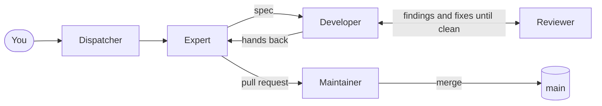
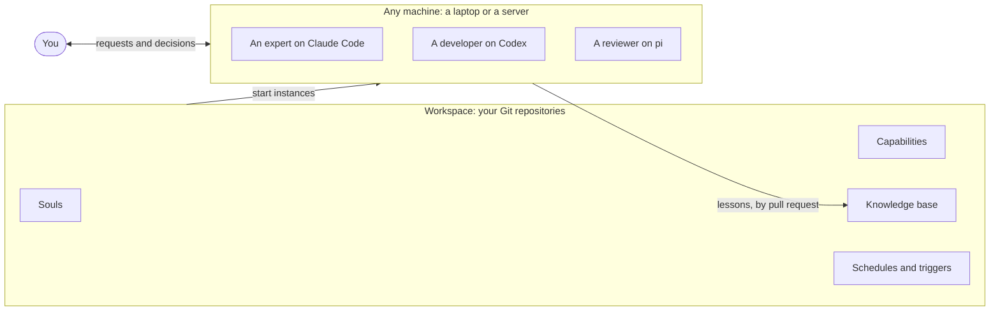

# OATS

**The Open Agent Team Specification.** Platform, provider and model agnostic agent teams. Define the agents your work needs in your own Git repositories, on GitHub, GitLab or another forge, and run them as a team on your machines with Claude Code, Codex or pi.

[](https://github.com/oats-project/oats/releases) [](LICENSE)

Free and open source.

> **Try it:** open Claude Code, Codex or pi in a project's folder and say *"Set up OATS for this project, following https://github.com/oats-project/oats"*. What you need, and what happens, is under [Start here](#start-here). An agent setting up OATS for someone goes there too.

## What OATS is

**OATS is a framework for building agent teams that are provider and model agnostic.** It has two parts:

- **Contracts** for defining agents: how you describe each kind of agent, and how each kind is assigned its own set of instructions, skills, tools and knowledge.
- **A command-line tool** that runs and manages the agents on your machines. It starts them, connects them and stops them, on your command, on a schedule or when something happens.

With the right tools, OATS gives you fully functional agent teams that coordinate however you want them to, across people and across machines, using the tools you already use. We provide defaults that we think work, but you can fully customise everything.

Everything is defined in Git, shared and access controlled by your forge. OATS needs no account, server or hosted service of its own.

Each agent is a session of an **agent harness** you already use, such as Claude Code, Codex or pi, started in a folder of its own, with the full power of that harness. By choice, OATS runs them as **terminal agents**, agents that run in a terminal, on your machines: a laptop or a server.

With our default messaging, [aweb](https://aweb.ai), every agent gets a cryptographically verifiable identity and secure agent to agent messaging, across vendors and harnesses: every message is signed, and end-to-end encrypted when you turn encryption on.

OATS also provides **OATS Desktop**, a free agent development environment (ADE) that makes working with your agents and coordinating them easier. It is optional.

## A new way to think about agents

Usually a repository has one `AGENTS.md`, the instructions every session reads, and a few **skills**, written procedures an agent loads when a task calls for one. Every session starts as the same generalist, and what it learns is lost when it ends, or scattered across the systems of different vendors.

OATS has you think of a project as worked on by several agents of different **kinds**, such as a code reviewer, a backend expert or a release manager. It is fully flexible: one generalist, or a whole team that coordinates its work. Each agent starts in a **home** of its own, a folder with its own `AGENTS.md`, the skills of its kind and only the instructions it needs. What it learns is kept for the next agent of its kind.

## The building blocks

Each block uses the ones before it.

- **Capability.** A bundle that gives agents one ability, such as messaging, knowledge, tasks or code review, shared by every kind of agent that uses it. It can ship skills, scripts, command-line tools and an **injection**: instructions OATS composes into the `AGENTS.md` of each agent that uses it.
- **Soul.** A kind of agent, such as a code reviewer or a backend expert. It defines the capabilities it uses, for the behaviours it shares with other souls, and its own `AGENTS.md` and skills, for what is unique to it. It is a folder in Git, changed by pull request.
- **Instance.** One agent at work: a soul started for one piece of work, as a terminal session of Claude Code, Codex or pi. Many instances of a soul can run at once. OATS composes each from its soul and its soul's capabilities, so it gets:
  - **its `AGENTS.md`:** the soul's own, then each capability's injection, then a short OATS section on where it works;
  - **its skills:** the soul's and every capability's;
  - **its scripts and command-line tools,** from its capabilities.
- **Workspace.** The space that bounds your agents: their souls, capabilities, knowledge, schedules and triggers, and the **teams** they work in, groups of agents that can message each other. It can span several Git repositories. An organisation has one workspace; its teams are labels within it, and the workspace can hold as many as it needs.

### An instance's home

What an instance is composed from lands in a home of its own. The home of a code reviewer, working on its own branch:

```text
code-reviewer instance home
├── AGENTS.md                     composed from:
│   ├── the soul's own AGENTS.md  role, responsibilities, boundaries
│   ├── code review injection     how to read a change and report findings
│   ├── messaging injection       how to reach other agents and people
│   ├── knowledge injection       how to consult and record what it learns
│   └── OATS section              where this instance works
├── CLAUDE.md → AGENTS.md         the same file, for agents that read CLAUDE.md
├── TASK.md                       the work it was started for
├── instance.json                 what it was given, and from where
├── .agents/skills/               the soul's skills plus every capability's
├── .oats/modules/                each capability, copied whole with its scripts and tools
│   ├── oats.code-review/
│   ├── oats.aweb/                messaging
│   ├── oats.okf/                 knowledge
│   └── acme-style-guide/
├── STATE.md, log.md, notes/      working notes its knowledge capability keeps
├── work/                         its own branch of the repository it works on
└── .work-<purpose>/              more branches or repositories, when the work needs them
```

The agent then starts normally in its home and reads its `AGENTS.md` and skills as it always would. A change to a capability reaches the next instance of every soul that uses it (for a package, once its new version is pinned); a change to a soul's `AGENTS.md` reaches only that soul's. Running instances keep what they started with.

## Capabilities

- **Three are core: knowledge, messaging and tasks.** They turn separate agents into a team: what they know, how they reach each other and people, and what work they share. Other capabilities build on them, so OATS defines a contract for each. Any capability that meets it can fill it, such as Jira or Linear for tasks, and an agent has **at most one of each**.
- **Any other capability** adds other know-how and behaviours you want your agents to have, such as planning engineering work or reaching your own systems.
- **Coordination** is the one that shapes a team most: how agents divide work, hand it over, review it and bring in a person. It is a capability, not part of OATS, so each team can work its own way and change it by pull request. Today `oats.engineering` provides it, and default coordination templates are coming.
- **Use a ready-made one or write your own.** Ready-made capabilities, and sometimes souls, come in **packages**. You pin each package to a version, so every agent gets exactly the same thing.
- **Official packages** cover engineering (expert, developer, code review, maintainer), knowledge, messaging, and tasks including Jira and Linear.

## Why souls are valuable

A soul turns how a kind of agent should work into something you can keep, review and share. It gives each instance:

- **its capabilities,** the set that defines its way of working;
- **its instructions,** its `AGENTS.md`: the closest thing the agent has to a system prompt;
- **its skills,** for its own kind of task;
- **its knowledge:** decisions, their reasons and lessons, kept by your knowledge capability in a **knowledge base**. By default each area of it has one owning soul, and a soul also reads the areas its work touches ([Knowledge and learning](docs/knowledge-and-learning.md)).

So:

- **Agents are focused.** An agent given only what its role needs does better work than one given every procedure and trusted to ignore most of them.
- **Expertise compounds.** Lessons stay with the soul, so each new instance starts wiser than the last.
- **Souls are portable.** Change the model or the agent, and the soul and its knowledge stay.
- **Souls are reviewed.** Changing how an agent works is a pull request.
- **Souls are shared.** One soul serves everyone who uses it, and you can adopt ready-made ones.
- **Souls can speciate.** When a kind of work outgrows a soul, it can split into more specialised souls, each with its own capabilities and knowledge. Souls can also widen or merge. Every such change is proposed and reviewed.

**Why dividing work this way doesn't lose.** Teams of agents often do worse than one agent when they split a problem among them. A team of souls done well never splits a problem; it splits responsibility and context:

- each soul holds a whole area, with the knowledge that goes with it;
- work that crosses areas stays whole with one agent that leads it, while the others answer for their own areas;
- each area of knowledge has one owning soul;
- small work can stay with one agent, often the best shape for it.

## What OATS gives you

- **Work bigger than one session.** Divided by responsibility and context, a team can take on work no single session could hold.
- **One way of working across agents.** Define once how your agents work; everyone's agents follow it, on Claude Code, Codex or pi.
- **Automations.** Schedules and triggers start agents without anyone typing.
- **Yours to keep.** Souls, knowledge and workflows live in your repositories, independent of any model or provider.

## Work the way you choose

- **Start from a default.** Packages ship ready-made souls, and default coordination templates, such as the one below, are coming. During setup, an agent called the setup expert adapts the defaults to your project with you.
- **Adapt it.** Change instructions, swap capabilities, add or drop roles, each by pull request.
- **Or build your own:** one generalist, a set of specialists, a team with a person approving every merge, agents that only run on a schedule. Messaging, knowledge and tasks are capabilities too, so you can bring your own tools.

## Example: the building of OATS

We are moving the building of OATS to this template. It has six kinds of agent, each holding one whole piece of work:

- **Dispatcher.** One per person, always running. You tell it what you want; it starts the work with the right expert, starting one if needed, and reports progress. It decides nothing about the work itself.
- **Expert.** Owns one area, such as the kernel or the Desktop, and that area's knowledge. It plans, writes the spec and acceptance tests, starts developers, checks their work and takes the pull request to the maintainer. A generalist expert owns the contracts between areas and leads work that crosses them.
- **Developer.** Builds one task from a spec on its own branch, works through the reviewer's findings, hands the branch back to the expert and retires.
- **Reviewer.** Reads the developer's change in a fresh context against the spec and tests, and reviews each fix until nothing is left. It never decides a merge.
- **Maintainer.** The merge gate for one part of the project. It merges where written rules allow and otherwise asks a person, and never plans the work it judges.
- **Routine.** A soul a schedule starts for each run of a recurring job, such as a morning digest.



You approve each piece of work once, at the expert's plan, and hear again only if the plan changes materially. Every change is reviewed three times: the reviewer reads the lines, the expert checks it against the plan, and the maintainer judges whether it belongs.

## How it works

### The workspace

The workspace's `oats-workspace.yaml` lists the repositories that take part, the packages at their pinned versions, its teams and which souls may join each, and the capabilities every soul gets by default. Each repository it lists links back with an `oats-membership.yaml` that names the repository holding `oats-workspace.yaml`, and that repository does too. A repository takes part only when both sides name each other, so neither can add the other on its own; a listed repository that doesn't link back contributes nothing. Each machine keeps its own settings, its lock and its agents' homes in a deployment directory of its own.



### Defining an agent

A soul is a folder in one of those repositories:

```text
souls/code-reviewer/
  soul.yaml     description, where it works, its capabilities
  AGENTS.md     its instructions
  okf.json      the knowledge areas it owns and reads, when it uses oats.okf
  skills/       skills only this soul needs
```

```yaml
schemaVersion: 2
name: code-reviewer
description: Reviews one change against its spec and reports findings.
work: worktree                          # each instance gets its own branch
capabilities:
  oats.code-review: { from: package }   # from a pinned package
  acme-style-guide: { from: here }      # from this repository
```

A soul can name any capability, including the ones for knowledge, messaging and tasks. It also gets the workspace's default capabilities, unless it turns them off. It can name a preferred agent and model too, which each machine or each start can override.

### Working with your agents

- **Start one** with a task in plain words from OATS Desktop, or let another agent, a schedule or a trigger start it.
- **OATS builds it** as above, gives it a working directory, and starts the agent normally. Nothing is wrapped or replaced.
- **Talk to it** in its terminal, as with any session.
- **Agents work together** by starting other agents, as their souls allow. With a messaging capability, they also message each other, as their teams and their controls allow.
- **An agent can ask you** for a decision, and waits for the answer.
- **It learns.** Lessons worth keeping go back into a real knowledge base by pull request. It can be organised by soul, each owning its own area, or as a more general knowledge base, as your knowledge capability supports.
- **It retires** when its work is done. The soul, and what it learned, remain.

OATS was founded on one claim: **an agent's expertise should be a versioned project artifact, not a side effect of a session.**

## Why we built it

Agents, coding agents in particular, can now do real work. The way most of us run them hasn't caught up:

- **Every session starts from zero.** Context is explained again and decisions are made again.
- **Everyone runs agents differently,** so an organisation's results depend on who is prompting.
- **Real work doesn't fit in one session.** Work that spans systems, hours or people outgrows a context window, and someone ends up coordinating sessions by hand.
- **Choosing a model is becoming choosing a platform.** Adopting a provider's memory, tools and workflows means starting again when you change model.

We believe:

- the way agents work should be yours: written down, reviewed, versioned and portable;
- machine intelligence should become a commodity, available from many providers, including models you run yourself;
- how agents are organised decides the quality of their work as much as the model does, and deserves the tools we give code.

## For your own projects

- **Any shape of team,** from one agent to a full team, changed as the project grows.
- **Work while you're away.** Schedules and triggers start or wake agents when nobody is at the keyboard.
- **You see who needs you.** The Desktop shows which agents are waiting on you.
- **Knowledge stays in your repositories,** ready for the next agent, whichever model it runs on.

## For organisations

OATS is where the organisation defines, once, how its agents work.

- **One canonical way of working.** Everyone's agents start from the same souls, with packages at the same pinned versions. A code reviewer reviews the same way on every team.
- **Any model, your choice of agent.** People keep the agent they prefer, with its full power. OATS adds the organisation's souls without replacing it, and agents on different tools work alike and can message each other.
- **No new interface to learn.** No one has to use OATS Desktop: agents are ordinary sessions in their own terminals.
- **Changes are reviewed like code.** A change to how agents work is a pull request to one of the workspace's repositories.
- **Knowledge grows for everyone.** Once accepted, one person's agents' lessons are there for every later instance of that soul.
- **Agents of different people work together,** messaging each other across their areas while each asks its own person for decisions.
- **No OATS server.** OATS works from Git, your forge and your agents; integrations you choose may run their own services.

## Schedules and triggers

Agents don't have to wait for someone to type. Schedules and triggers are part of the team, like its souls.

- **A schedule** runs at set times in the time zone it names. It starts a new agent with a task, runs a command, or wakes a running agent with a message.
- **A trigger** starts a new agent when an event matches: a GitHub pull request opened, labelled or updated, or an event from a source a capability provides.
- **Shared or local.** Kept in the workspace, they are reviewed like everything else and run on the machine they name; or keep them local to one machine. On a server they keep running while your laptop sleeps.

For example, every knowledge harvest pull request can get its own reviewer agent minutes after it opens.

## OATS Desktop

A free agent development environment for macOS and Linux (x64) that puts a workspace in one window:

- every soul and running agent, and which agent started which;
- any agent's live terminal, files, notes and knowledge;
- starting, stopping, retiring and scheduling agents, and your triggers;
- which agents are waiting on you, and what each is asking;
- agents on several machines, including servers.

It is optional: agents run, message each other and follow their schedules whether it is open or not.

## Start here

**If you are a person,** your coding agent does the setup for you.

1. **You need** macOS or Linux, a coding agent (Claude Code, Codex or pi) and a GitHub account. Without a GitHub account, you make a free one during setup. Windows is not supported.
2. **Open your agent in the folder of a project** you want agents to help with, and say:

   > Set up OATS for this project, following https://github.com/oats-project/oats

3. **Answer its questions.** It asks everything in one round and lists the changes it will make to your computer; say yes to them. After that you only approve the GitHub login and type a password or token if one is asked for.

Your agent then installs OATS, OATS Desktop and what they need. It creates a private GitHub repository for your agents' shared setup (the workspace), creates the group your agents message each other in (on [aweb](https://aweb.ai), with no sign-up), and starts the **setup expert**, an agent that adapts the defaults with you. OATS Desktop opens on it. Allow 5 to 10 minutes.

**To join a workspace a teammate already runs,** say instead *"Join our OATS workspace at \<its GitHub repository\>, following https://github.com/oats-project/oats"*. Your teammate's agent makes you an invite, which your teammate passes to you privately; your agent tells you when to paste it.

**If you are an agent** asked to set up, install or try OATS, download the `oats-getting-started` skill and follow it step by step. It is the whole procedure; don't improvise one from this README.

```bash
curl -fsSL https://raw.githubusercontent.com/oats-project/oats/main/skills/oats-getting-started/SKILL.md
```

Download it rather than web-fetching it: a summarising fetch would lose its exact commands.

## Learn more

- [Souls and instances](docs/souls-and-instances.md)
- [Workspaces](docs/workspaces.md)
- [Capabilities](docs/capabilities.md), [packages](docs/packages.md) and the [official catalog](docs/official-catalog.md)
- [Knowledge and learning](docs/knowledge-and-learning.md), and in depth, [knowledge, instances and evolving expertise](docs/knowledge-theory.md)
- [Schedules and triggers](docs/schedules.md)
- [OATS Desktop](docs/desktop.md)
- [Release notes](docs/release-notes/)

## Contributing

Source, issues and pull requests live at [oats-project/oats](https://github.com/oats-project/oats). The [implementation guide](docs/implementation.md) covers the repository and the [release lane](docs/release-lane.md) how releases are verified and published. Read the [release notes](docs/release-notes/) before changing an existing deployment.

## Origins and licence

OATS began as **OAS, Open Agent Specialization**, designed and written by Josep (Pepe) Garcia-Reyero Sais. The architecture, kernel, package engine, Desktop and official packages are his work; OATS continues it under its current name. It grew from the a2am team architecture and builds on open formats, including AGENTS.md, Agent Skills and Open Knowledge Format.

OATS is free and [MIT-licensed](LICENSE). Models and services a deployment chooses may have their own licences and costs.
